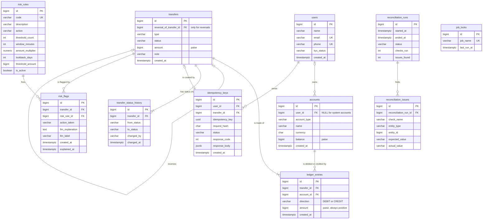

# Schema Design

## 1. Noun list

| Noun | Table? | Reason |
|---|---|---|
| Platform | No | Only one platform, so nothing to store |
| User | Yes → `users` | We store name, email, phone, KYC status |
| Name, email, phone, KYC status | No | Attributes of a user |
| Wallet | Yes → `accounts` | Holds money and has a balance |
| System account (cash-in, cash-out, fee revenue) | Same `accounts` table | Behaves like a wallet (has entries and a balance), just has no user |
| Currency | No | Attribute of an account (always INR) |
| Transfer | Yes → `transfers` | The business event; has type, status, amount, created time |
| Type, status, amount, created time | No | Attributes of a transfer |
| Reversal | No | A transfer type; link to the original is a column on `transfers` |
| Ledger entry | Yes → `ledger_entries` | Each debit or credit line of a transfer |
| Debit / credit | No | Attribute (direction) of a ledger entry |
| Balance | No | Attribute of an account |
| Statement | No | A query over ledger entries |
| Idempotency key | Yes → `idempotency_keys` | Stores user, key, request hash, status, saved response |
| Request body, response | No | Attributes of an idempotency key |
| Audit log (status changes) | Yes → `transfer_status_history` | One row per status change, with who and when |
| Who changed it | No | Attribute of the audit row; no admin details are required |
| Fraud rule | Yes → `risk_rules` | Thresholds must be stored in a table, not in code |
| Flag | Yes → `risk_flags` | Rule fired, transfer, LLM explanation and label |
| Review / held | No | A status of a transfer |
| Nightly job run | Yes → `reconciliation_runs` | One row per run (start, end, status, counts) |
| Mismatch | Yes → `reconciliation_issues` | One row per problem found |
| Job lock | Yes → `job_locks` | Ensures only one reconciliation run at a time |
| Question / answer | No | Answered on the fly from the ledger; nothing stored |

### Final tables (11)

- `users`
- `accounts`
- `transfers`
- `ledger_entries`
- `transfer_status_history`
- `idempotency_keys`
- `risk_rules`
- `risk_flags`
- `reconciliation_runs`
- `reconciliation_issues`
- `job_locks`

## 2. Attributes

### users
| Column | Type | Notes |
|---|---|---|
| id | BIGINT | Primary key, system-generated |
| name | VARCHAR(100) | |
| email | VARCHAR(255) | |
| phone | VARCHAR(15) | |
| kyc_status | VARCHAR(20) | PENDING, VERIFIED, REJECTED |
| created_at | TIMESTAMPTZ | |

### accounts
| Column | Type | Notes |
|---|---|---|
| id | BIGINT | Primary key |
| account_type | VARCHAR(20) | USER_WALLET, SYSTEM |
| name | VARCHAR(50) | e.g. Main, Savings, CASH_IN, CASH_OUT, FEE_REVENUE |
| currency | CHAR(3) | Always INR |
| balance | BIGINT | Stored balance in paise |
| created_at | TIMESTAMPTZ | |

### transfers
| Column | Type | Notes |
|---|---|---|
| id | BIGINT | Primary key |
| type | VARCHAR(20) | TOPUP, PEER_TRANSFER, WITHDRAWAL, FEE, REVERSAL |
| status | VARCHAR(20) | COMPLETED, HELD, REJECTED, REVERSED |
| amount | BIGINT | Paise |
| note | VARCHAR(255) | Optional user note (used in Milestone 5) |
| created_at | TIMESTAMPTZ | |

### ledger_entries
| Column | Type | Notes |
|---|---|---|
| id | BIGINT | Primary key |
| direction | VARCHAR(6) | DEBIT, CREDIT |
| amount | BIGINT | Always positive, in paise |
| created_at | TIMESTAMPTZ | |

### transfer_status_history
| Column | Type | Notes |
|---|---|---|
| id | BIGINT | Primary key |
| from_status | VARCHAR(20) | Empty for the first status |
| to_status | VARCHAR(20) | |
| changed_by | VARCHAR(100) | SYSTEM, or the admin who changed it |
| changed_at | TIMESTAMPTZ | |

### idempotency_keys
| Column | Type | Notes |
|---|---|---|
| id | BIGINT | Primary key |
| idempotency_key | UUID | Sent by the client in the header |
| request_hash | CHAR(64) | SHA-256 hash of the request body |
| status | VARCHAR(20) | IN_PROGRESS, COMPLETED |
| response_code | INT | Saved HTTP status code |
| response_body | JSONB | Saved response |
| created_at | TIMESTAMPTZ | |

### risk_rules
| Column | Type | Notes |
|---|---|---|
| id | BIGINT | Primary key |
| code | VARCHAR(50) | VELOCITY, AMOUNT_SPIKE, NEW_PAYEE_LARGE_AMOUNT |
| description | VARCHAR(255) | |
| action | VARCHAR(20) | HOLD, FLAG_ALLOW |
| threshold_count | INT | e.g. 5 transfers (velocity) |
| window_minutes | INT | e.g. 10 minutes (velocity) |
| amount_multiplier | NUMERIC(5,2) | e.g. 5× average (amount spike) |
| lookback_days | INT | e.g. 30 days (amount spike) |
| threshold_amount | BIGINT | e.g. 1000000 paise = ₹10,000 (new payee) |
| is_active | BOOLEAN | |

### risk_flags
| Column | Type | Notes |
|---|---|---|
| id | BIGINT | Primary key |
| action_taken | VARCHAR(20) | HOLD, FLAG_ALLOW |
| llm_explanation | TEXT | Two-sentence explanation from the LLM |
| llm_label | VARCHAR(20) | likely_ok, review, likely_fraud |
| created_at | TIMESTAMPTZ | When the rule fired |
| explained_at | TIMESTAMPTZ | When the nightly job added the explanation |

### reconciliation_runs
| Column | Type | Notes |
|---|---|---|
| id | BIGINT | Primary key |
| started_at | TIMESTAMPTZ | |
| ended_at | TIMESTAMPTZ | |
| status | VARCHAR(20) | RUNNING, PASSED, FAILED |
| checks_run | INT | |
| issues_found | INT | |

### reconciliation_issues
| Column | Type | Notes |
|---|---|---|
| id | BIGINT | Primary key |
| check_name | VARCHAR(50) | Which check found it |
| entity_type | VARCHAR(20) | LEDGER, TRANSFER, ACCOUNT, LEDGER_ENTRY |
| entity_id | BIGINT | ID of the problem row; empty for whole-ledger checks (LEDGER) |
| expected_value | VARCHAR(100) | |
| actual_value | VARCHAR(100) | |

### job_locks
| Column | Type | Notes |
|---|---|---|
| id | BIGINT | Primary key |
| job_name | VARCHAR(50) | e.g. RECONCILIATION |
| last_run_at | TIMESTAMPTZ | |

## 3. Relationships

| # | Pair | Side A → B | Side B → A | Cardinality | Foreign key placed on |
|---|---|---|---|---|---|
| 1 | users – accounts | One user has 0..many accounts | One account belongs to 0..1 user (system accounts have none) | 1:M | `accounts.user_id` (NULL for system accounts) |
| 2 | transfers – ledger_entries | One transfer has 2..many entries | One entry belongs to exactly 1 transfer | 1:M | `ledger_entries.transfer_id` |
| 3 | accounts – ledger_entries | One account has 0..many entries | One entry is on exactly 1 account | 1:M | `ledger_entries.account_id` |
| 4 | transfers – transfers (reversal) | One transfer is reversed at most once | One reversal points to exactly 1 original | 1:1 (self) | `transfers.reversal_of_transfer_id` (only reversals fill it) |
| 5 | transfers – transfer_status_history | One transfer has 1..many status changes | One change belongs to exactly 1 transfer | 1:M | `transfer_status_history.transfer_id` |
| 6 | users – idempotency_keys | One user has 0..many keys | One key belongs to 0..1 user (NULL for `POST /users` and admin requests) | 1:M | `idempotency_keys.user_id` |
| 7 | idempotency_keys – transfers | One key creates 0..1 transfer (e.g. "create user" creates none) | One transfer comes from 0..1 key | 1:1 (optional) | `idempotency_keys.transfer_id` |
| 8 | transfers – risk_rules | One transfer can trigger 0..many rules | One rule can fire on 0..many transfers | M:N | Mapping table `risk_flags` (`transfer_id`, `risk_rule_id`) |
| 9 | reconciliation_runs – reconciliation_issues | One run finds 0..many issues | One issue belongs to exactly 1 run | 1:M | `reconciliation_issues.reconciliation_run_id` |

### Pairs with no direct link (and why)

- **users – transfers:** A transfer is linked to users only through its ledger entries → accounts → users. A direct link would duplicate that and could go out of sync.
- **job_locks – reconciliation_runs:** The lock row is looked up by `job_name`; it doesn't need to point to a run.
- **transfer_status_history.changed_by:** Stored as text, not a foreign key, because admins are not stored in a table.

### Foreign key columns added (all BIGINT)

| Table | New column | References |
|---|---|---|
| accounts | user_id | users.id |
| ledger_entries | transfer_id | transfers.id |
| ledger_entries | account_id | accounts.id |
| transfers | reversal_of_transfer_id | transfers.id |
| transfer_status_history | transfer_id | transfers.id |
| idempotency_keys | user_id | users.id |
| idempotency_keys | transfer_id | transfers.id |
| risk_flags | transfer_id | transfers.id |
| risk_flags | risk_rule_id | risk_rules.id |
| reconciliation_issues | reconciliation_run_id | reconciliation_runs.id |

## 4. Constraints

### 4.1 Required by the assignment

| Rule | How it is enforced |
|---|---|
| Ledger entry amounts are positive, direction stored separately | `CHECK (amount > 0)` and `CHECK (direction IN ('DEBIT','CREDIT'))` on `ledger_entries` |
| A user wallet's balance never goes negative (system accounts may) | `CHECK (account_type = 'SYSTEM' OR balance >= 0)` on `accounts` |
| Ledger entries are insert-only | A trigger that raises an error on any UPDATE, DELETE or TRUNCATE of `ledger_entries` |
| Idempotency key is unique per user | `UNIQUE NULLS NOT DISTINCT (user_id, idempotency_key)` on `idempotency_keys`; requests with no user (`POST /users`, admin) share one NULL group |
**Why positive amounts + direction (not signed amounts):** A single `CHECK (amount > 0)` blocks zero and wrong-sign values, and "sum of debits = sum of credits" reads exactly like the accounting rule. With signed amounts, a sign mistake would silently flip the money's direction.

### 4.2 Additional constraints

| Table | Constraint | Why |
|---|---|---|
| All tables | Primary key on `id` (`GENERATED ALWAYS AS IDENTITY`) | System-generated, never supplied by the client |
| All tables | Foreign keys from Step 3 | No entry without a transfer, no entry on a missing account |
| All tables | `NOT NULL` on every column except the optional ones below | No half-filled rows |
| accounts | `CHECK ((account_type = 'USER_WALLET' AND user_id IS NOT NULL) OR (account_type = 'SYSTEM' AND user_id IS NULL))` | Wallets must have an owner; system accounts must not |
| accounts | `CHECK (currency = 'INR')` | Only INR is supported |
| accounts | `UNIQUE (name)` for system accounts only (partial unique index) | Exactly one CASH_IN, CASH_OUT, FEE_REVENUE |
| transfers | `CHECK (amount > 0)` | No zero or negative transfers |
| transfers | `CHECK` on `type` and `status` values | Only the allowed values |
| transfers | `UNIQUE (reversal_of_transfer_id)` | A transfer can be reversed only once |
| transfers | `CHECK ((type = 'REVERSAL') = (reversal_of_transfer_id IS NOT NULL))` | Only reversals point to an original, and every reversal must |
| users | `UNIQUE (email)`, `UNIQUE (phone)` | No duplicate users (but neither is a primary key) |
| users | `CHECK` on `kyc_status` values | Only the allowed values |
| risk_flags | `UNIQUE (transfer_id, risk_rule_id)` | One flag per rule per transfer |
| risk_rules | `UNIQUE (code)` | One row per rule |
| job_locks | `UNIQUE (job_name)` | One lock row per job |

**Optional (nullable) columns:** `accounts.user_id`, `transfers.note`, `transfers.reversal_of_transfer_id`, `transfer_status_history.from_status`, `idempotency_keys.response_code`, `idempotency_keys.response_body`, `idempotency_keys.transfer_id`, the rule-specific threshold columns in `risk_rules`, `risk_flags.llm_explanation`, `risk_flags.llm_label`, `risk_flags.explained_at`, `reconciliation_runs.ended_at`, `job_locks.last_run_at`,`idempotency_keys.user_id`, `reconciliation_issues.entity_id`.

### 4.3 Indexes (for real queries)		

PostgreSQL does **not** create indexes on foreign key columns automatically, so these are added deliberately.

| Index | Used by |
|---|---|
| `ledger_entries (account_id, created_at DESC, id DESC)` | Wallet statement, newest first; computing a balance |
| `ledger_entries (transfer_id)` | Fetching a transfer's entries; per-transfer reconciliation check |
| `accounts (user_id)` | Listing a user's wallets |
| `transfer_status_history (transfer_id)` | Transfer status history in `GET /transfers/{id}` |
| `reconciliation_issues (reconciliation_run_id)` | Run report |
| `transfers (created_at) WHERE status = 'HELD'` (partial index) | Admin risk queue, oldest first |
| `UNIQUE NULLS NOT DISTINCT (user_id, idempotency_key)` | Already an index; used for every POST lookup |

**Write cost:** Every insert into `ledger_entries` must also update its 2 indexes. That's why we index only for queries we actually run. Indexes for the fraud rules will be added in Milestone 5, after measuring them.

## 5. ER Diagram

